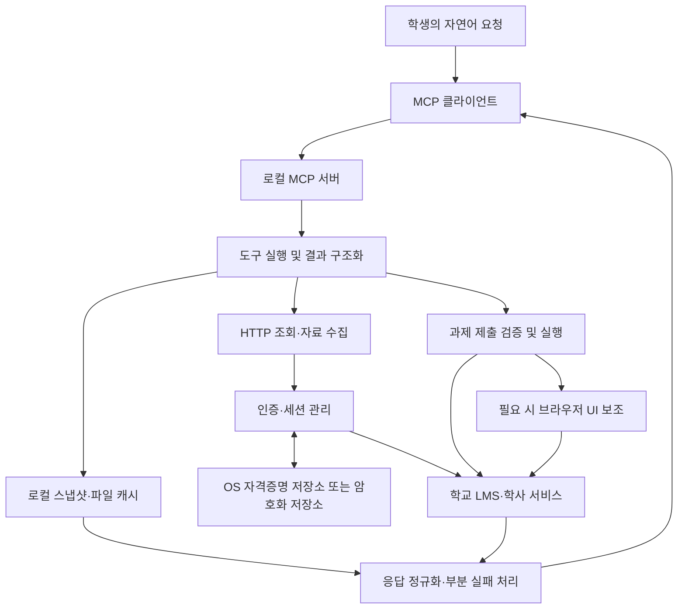

# CAU e-Class MCP — 같은 자료를, 더 적은 요청으로

**강의 6개의 자료 목록 조회를 13.061초에서 2.815초로. HTTP 요청은 514회에서 24회로 줄이고, 반환된 자료 54개는 동일하게 유지했습니다.**

중앙대학교 e-Class를 Claude·Codex 등 MCP 클라이언트에서 사용할 수 있게 연결하는 비공식 프로젝트입니다. 이 저장소는 프로젝트의 배포 안내와 아키텍처·성능 분석을 공개하는 쇼케이스입니다. 구현체와 인증 프로토콜 분석 자료는 별도 Private 저장소에서 관리합니다.

학생에게 필요한 것은 화면을 대신 클릭하는 과정이 아니라, 마감 과제와 강의 자료를 빠르게 확인하는 결과입니다. 이를 위해 조회 경로를 브라우저 화면 로딩에서 HTTP 기반 수집으로 전환하고, 같은 결과를 반환하는지와 실행 비용이 얼마나 줄었는지를 함께 측정했습니다.

## 배포 안내

[Releases](https://github.com/jseook11/cau-eclass-mcp/releases)에서 사전 빌드 배포 상태를 확인할 수 있습니다. **현재 네이티브 바이너리는 배포 준비 중이며, 다운로드 가능한 바이너리 릴리스는 없습니다.** 소스 설치 방식의 이전 릴리스는 비공개 구현체 저장소에 보존했습니다.

프로젝트는 강의·과제·성적·공지 조회, 강의 자료 수집, 시험 시간표·강의계획서 조회와 과제 제출 도구를 제공합니다. 기능 범위와 실행 환경은 향후 각 바이너리 릴리스에서 안내합니다. 학교의 공식 서비스가 아니며, 본인 계정의 학습 데이터를 다루는 개인 학습 도구입니다.

## 벤치마크: 결과를 유지하면서 실행 비용 줄이기

2026년 10월 8일 KST, 같은 학기의 강의 6개를 순차 조회했습니다. 브라우저 기반 구현과 HTTP 기반 구현을 각각 새 프로세스로 5회 실행하고, 실행 순서를 번갈아 배치했습니다. 아래 값은 각 조건의 중앙값입니다.

| 지표 | 브라우저 기반 조회 | HTTP 기반 조회 | 감소율 |
| --- | ---: | ---: | ---: |
| 전체 실행시간 | 13.061초 | 2.815초 | 78.4% |
| 최대 관측 RSS, 프로세스 트리 합산 | 785.0 MiB | 180.1 MiB | 77.1% |
| CPU 시간, user + system | 6.98초 | 0.28초 | 96.0% |
| 관측 HTTP 요청 수 | 514회 | 24회 | 95.3% |
| 반환 자료 | 54개 | 54개 | 동일 |

전체 실행시간 기준 **약 4.64배** 빨라졌습니다. 감소율은 두 조건의 중앙값 차이를 브라우저 기반 조건의 중앙값으로 나눈 값입니다.

### 결과가 같다는 것을 어떻게 확인했나

강의별 자료 개수는 두 구현 모두 5·0·35·7·6·1개였습니다. 강의 식별자와 자료 식별자·제목·유형·URL을 정렬해 SHA-256 해시로 비교했고, 10회 실행 모두 같은 해시를 반환했습니다. 빈 자료 목록도 성공 응답으로 확인했습니다.

이 검증은 **두 구현의 반환 결과가 같음**을 뜻합니다. 독립적인 원본 목록과 대조한 것은 아니므로, 모든 자료를 빠짐없이 수집한다는 절대 정확도 주장은 하지 않습니다. 원시 결과에는 내부 정보를 포함할 수 있어 공개하지 않습니다.

## 아키텍처: 화면 대신 필요한 데이터를 수집하기

조회·자료 수집은 HTTP로 처리합니다. 브라우저 UI 보조는 과제 제출의 일부 경로에 남아 있으며, 프로젝트 전체가 브라우저 없이 동작한다는 의미는 아닙니다.

인증은 유효한 캐시를 먼저 사용하고 필요할 때 갱신합니다. 비밀번호와 세션은 OS 자격증명 저장소 또는 암호화 저장소에서 관리합니다. 캐시와 다운로드 파일은 로컬에 저장하고, 도구 결과는 연결된 MCP 클라이언트에 전달합니다. 과제 제출은 기본적으로 사전 검증하며, 실제 제출과 재제출에 확인 절차를 둡니다.

공개 다이어그램은 구성요소의 책임과 데이터 흐름을 설명합니다. 내부 엔드포인트, 인증 메시지 형식, 세션 핸드셰이크 순서는 포함하지 않습니다.

## 네트워크 프로파일링: 490회 차이는 어디서 나왔나

같은 강의 6개를 각 구현으로 1회씩 추가 조회해 요청 유형을 집계했습니다. 추가 실행에서도 반환 결과의 해시는 앞선 비교와 같았습니다.

| 브라우저 요청 유형 | 관측 요청 수 |
| --- | ---: |
| JavaScript | 168 |
| CSS | 66 |
| 이미지 | 36 |
| 폰트 | 154 |
| HTML 문서 | 12 |
| fetch·XHR | 72 |
| ping | 6 |
| **합계** | **514** |

**JavaScript·CSS·이미지·폰트만 424회로, 전체의 약 82.5%였습니다.** 브라우저 기반 구현은 강의마다 새 컨텍스트에서 화면을 로딩한 뒤 자료 목록 응답을 수집했습니다. 컨텍스트 간 일반적인 브라우저 HTTP 캐시를 재사용하지 않아 화면 리소스 로딩이 반복됐습니다.

HTTP 기반 구현은 화면 리소스를 실행하지 않고 필요한 인증·데이터 요청만 수행해 총 24회를 기록했습니다. 브라우저 기반 조건에서는 Chromium이 실행마다 7회 시작됐고, HTTP 조건에서는 0회였습니다. 화면 로딩을 생략한 것이 요청 감소의 주된 원인이며, 자식 브라우저 프로세스를 실행하지 않은 점도 메모리·CPU 비용 차이를 설명합니다.

요청 수는 HTTP 클라이언트와 브라우저의 요청 이벤트를 계수한 값입니다. 패킷 캡처로 검증한 네트워크 계층 전송 횟수는 아닙니다.

## 추가 실험: 동시 처리 수와 실행 환경

HTTP 조회 함수의 작업 풀에서 동시에 처리하는 강의 수를 1·2·3·6개로 제한했습니다. 모든 조건에서 같은 강의 6개를 전체 조회했고, 조건별 5회, 총 20회 실행했습니다. 실행 순서는 회차마다 순환했습니다.

| 동시 처리 강의 수 | 전체 실행시간 중앙값 | 최대 관측 RSS 중앙값 | 반환 결과 |
| --- | ---: | ---: | --- |
| 1 | 2.902초 | 180.5 MiB | 54개, 동일 해시 |
| 2 | 1.599초 | 180.4 MiB | 54개, 동일 해시 |
| 3 | 1.256초 | 180.7 MiB | 54개, 동일 해시 |
| 6 | 0.902초 | 181.4 MiB | 54개, 동일 해시 |

동시 6개 조건은 이번 실험의 순차 조건보다 약 3.22배 빨랐으며, 모든 실행의 요청 수는 24회였습니다. 앞선 순차 비교의 2.815초와 이번 2.902초는 서로 다른 시점의 측정값입니다.

**이 작업 풀은 벤치마크에만 추가했으며, 제품의 동시 처리 정책을 변경한 결과가 아닙니다.** 더 많은 동시 요청의 안정성이나 학교 서버의 허용 한도를 검증하지 않았으므로, 이 수치를 요청량 확대의 근거로 사용하지 않습니다.

동시 6개 조건을 컴파일된 JavaScript와 Node로 추가 5회 실행한 결과, 전체 실행시간 중앙값은 **0.833초**, 최대 관측 RSS 중앙값은 **119.2 MiB**였습니다. 개발 실행기인 tsx를 포함한 앞선 조건은 0.902초·181.4 MiB였습니다. 두 측정은 다른 시점에 진행했으며 네트워크 변동도 포함하므로, 실행시간 차이 전체를 실행기 비용으로 단정할 수 없습니다. 이 역시 자료 조회 하네스의 결과이며 전체 MCP 서버 메모리 측정은 아닙니다.

## 측정 조건과 해석 범위

- Apple M4 arm64, Node.js 24.20.0. 브라우저 조건은 Playwright 1.60.0을 사용했습니다.
- 각 실행은 새 프로세스와 기존 로그인·API 토큰 캐시를 사용했습니다. 신규 로그인, 토큰 발급, 영상 재생, 과제 제출, 파일 다운로드는 포함하지 않았습니다.
- 기존 구현의 소스를 별도 디렉터리에 추출하고 현재 구현과 설치된 의존성을 공유했습니다. 각 버전을 독립 설치한 배포 패키지 비교는 아닙니다.
- 전체 실행시간은 프로세스 시작부터 종료 관측까지로, 모듈 로딩과 종료 확인의 짧은 지연을 포함합니다. 실제 조회 구간의 중앙값은 브라우저 조건 12.710초, HTTP 순차 조건 2.609초였습니다.
- RSS는 약 50ms 대기 간격으로 프로세스와 자식들의 값을 합산한 최대 관측값입니다. 관측 자체의 실행 시간이 추가되며, 짧은 피크를 놓치거나 공유 메모리를 중복 합산할 수 있습니다. CPU 시간은 운영체제의 user + system 값으로 자식 프로세스 비용을 포함합니다.
- 첫 비교에서 브라우저 요청 수는 514–517회, HTTP 요청 수는 매번 24회였습니다. 요청 유형 표는 추가 1회 관측값입니다.
- 학사 포털 조회는 두 구현 모두 실패해 공통 성공 작업 비교에서 제외했습니다. 이 결과를 포털 조회 성능 개선으로 해석할 수 없습니다.
- 동시 처리 실험의 RSS 범위는 순차 180.4–212.3 MiB, 동시 2개 180.2–180.7 MiB, 3개 180.4–181.3 MiB, 6개 181.3–181.8 MiB였습니다.
- 이 수치는 특정 시점의 강의 6개 자료 목록 조회에 대한 것입니다. 다른 API, 콜드 로그인, 다운로드, 장시간 운영의 성능이나 안정성으로 일반화하지 않습니다.

## 🔒 Security & Source Code Policy

본 프로젝트는 학교 LMS 서버의 보호와 무분별한 스크래핑 어뷰징(Rate-limit 유발) 방지를 위해, 내부 LTI 인증 역공학 및 세션 핸드셰이크 관련 코어 소스코드를 Private으로 전환하여 관리하고 있습니다. 일반 사용자용 사전 빌드된 네이티브 바이너리는 Releases 탭을 통해 배포할 예정이며, 현재는 배포 준비 중입니다. 아키텍처 설계 및 성능 최적화 과정은 본 문서의 벤치마크 리포트를 참고해 주시기 바랍니다.

소스 비공개화만으로 요청량 제한이나 안전한 사용이 보장되는 것은 아닙니다. 실제 사용 시 본인 계정의 학습 데이터만 다루고, 학교 서비스 정책과 서버 부하를 고려해야 합니다.
